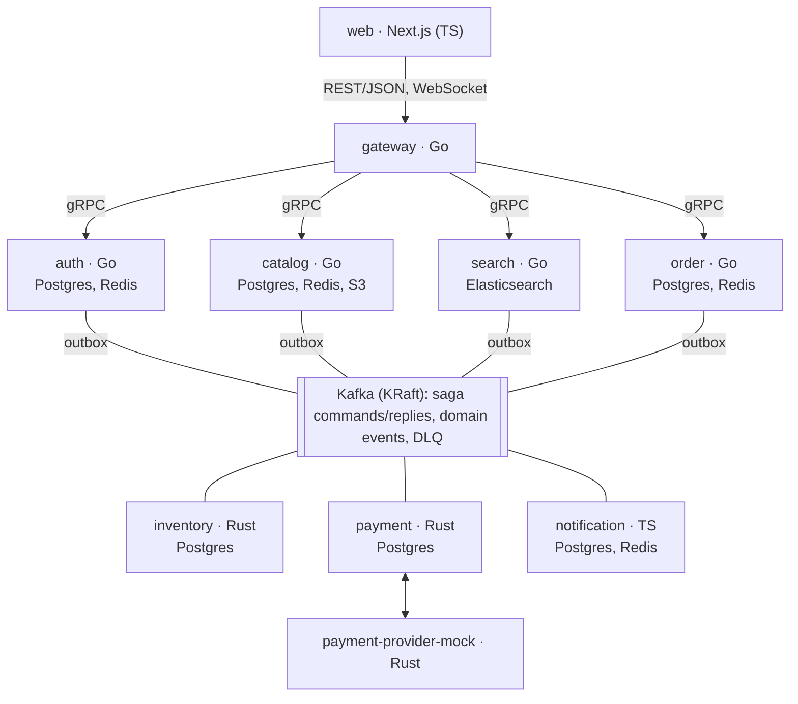

# Polka — ТЗ маркетплейса

> Specification, rev 22 (2026-11-14). Decisions taken during the work are recorded in [`spec-questions.md`](spec-questions.md).

## 1. Цель и границы проекта

Polka — учебный мультипродавцовый маркетплейс для портфолио. Цель — показать проектирование и реализацию микросервисной системы с распределёнными транзакциями, событийной интеграцией и развёртыванием в Kubernetes. Коммерческая эксплуатация не планируется.

**Стек**

| Слой | Технологии |
|---|---|
| Бэкенд | Go 1.23+, Rust (stable, edition 2021), TypeScript (Node.js 22) |
| Фронтенд | Next.js 15 (App Router), TypeScript, Tailwind CSS |
| Синхронное взаимодействие | gRPC (protobuf, buf), REST/JSON только на внешнем периметре |
| Асинхронное взаимодействие | Apache Kafka (KRaft), Protobuf-сообщения |
| Хранилища | PostgreSQL 16, Redis 7, Elasticsearch 8 (или OpenSearch 2), MinIO (S3) |
| Инфраструктура | Docker, docker compose, Kubernetes (kind/k3d), Helm, Strimzi |
| Наблюдаемость | OpenTelemetry, Prometheus, Grafana, Jaeger, Loki |
| CI | GitHub Actions |

Входит в MVP: регистрация с подтверждением email и сбросом пароля, каталог с вариантами товаров (SKU), поиском и фото, корзина, оформление заказа с резервированием и оплатой через фейковый провайдер, кабинет продавца с учётом баланса (двойная запись, комиссия площадки), уведомления о статусе заказа.

Не входит: реальные платежи и выплаты продавцам, возвраты по инициативе покупателя после оплаты, валюты кроме рубля, модерация новых продавцов, доставка и логистика, отзывы и рейтинги, чат, промокоды, собственный дизайн, мобильное приложение, облачный деплой.

## 2. Роли и функциональные требования

В системе три роли. Один аккаунт может быть одновременно покупателем и продавцом: магазин создаётся из личного кабинета.

| Роль | Кто это | Ключевые возможности |
|---|---|---|
| Покупатель (buyer) | любой зарегистрированный пользователь | поиск, корзина, заказы, история |
| Продавец (seller) | пользователь с магазином | товары, остатки, свои заказы |
| Администратор (admin) | создаётся сидом при деплое | категории, модерация товаров, блокировка пользователей |

### 2.1. Покупатель

- FR-B1. Регистрация по email и паролю, вход, выход, обновление сессии.
- FR-B1a. Подтверждение email по ссылке из письма (токен живёт 24 ч, можно запросить повторно не чаще раза в минуту). Без подтверждённого email можно смотреть каталог и собирать корзину, но нельзя оформить заказ и создать магазин.
- FR-B1b. Сброс пароля по ссылке из письма (токен живёт 1 ч, одноразовый). После сброса все refresh-токены пользователя отзываются. Ответ на запрос сброса одинаковый для существующего и несуществующего email.
- FR-B2. Просмотр каталога без авторизации: дерево категорий, карточка товара с фото, продавцом и выбором варианта; цена и наличие меняются при выборе варианта.
- FR-B3. Полнотекстовый поиск с опечатками (fuzzy), автодополнением, фильтрами (категория, цена, продавец, характеристики вариантов, в наличии) и сортировкой (релевантность, цена, новизна). В выдаче один товар = одна карточка с ценой «от …». Фасеты с количеством товаров.
- FR-B4. Корзина на уровне вариантов: добавить, изменить количество, удалить. Корзина живёт 30 дней.
- FR-B5. Оформление заказа из корзины. Если в корзине товары нескольких продавцов, создаётся один заказ с подзаказами по продавцам; оплата одна на весь заказ. Валюта — только рубль.
- FR-B6. Статус заказа обновляется на странице в реальном времени (WebSocket), дублируется письмом.
- FR-B7. История заказов; отмена заказа до оплаты. После оплаты покупатель заказ не отменяет.

### 2.2. Продавец

- FR-S1. Создание магазина (название, slug, описание, логотип) сразу, без одобрения. Условие — подтверждённый email. Один магазин на аккаунт; после создания пользователь получает роль seller.
- FR-S2. CRUD товаров: название, описание, категория, общие атрибуты (JSONB), до 10 фото. Статусы товара: draft → active → archived, плюс blocked от админа. Опубликовать можно только товар хотя бы с одним вариантом.
- FR-S2a. Варианты товара (SKU): до двух осей характеристик (например, «Размер» и «Цвет»), до 50 вариантов на товар. У каждого варианта свои артикул, цена и остаток. Товар без характеристик = товар с одним вариантом.
- FR-S3. Загрузка фото напрямую в S3 по presigned URL; сервер делает превью.
- FR-S4. Управление остатками по вариантам: установить количество, видеть зарезервированное и доступное.
- FR-S5. Список своих подзаказов; перевод подзаказа в shipped и delivered (доставка имитируется ручной отметкой).
- FR-S6. Баланс магазина: «в ожидании» (заказ оплачен, подзаказ ещё не доставлен) и «доступно» (после delivered). В баланс попадает сумма подзаказа минус комиссия площадки 10 % (задаётся в конфиге). История операций по балансу. Выплаты не реализуются.
- FR-S7. Простая статистика: выручка и число заказов за период.

### 2.3. Администратор

- FR-A1. Управление деревом категорий.
- FR-A2. Блокировка товара или пользователя; заблокированный товар исчезает из поиска не позднее чем через 5 с, токены заблокированного пользователя перестают действовать сразу.
- FR-A3. Панель фейкового платёжного провайдера: доля отказов и задержка ответа для демонстрации компенсаций.

### 2.4. Ключевые сценарии

- Продавец создаёт товар с вариантами и публикует его → через ≤ 5 с товар находится поиском.
- Покупатель оформляет заказ → резерв → оплата → заказ подтверждён, продавец видит подзаказ и сумму «в ожидании» на балансе.
- Оплата отклонена → резерв снят, заказ отменён, покупатель уведомлён.
- Два покупателя одновременно покупают последний экземпляр варианта → ровно один заказ проходит, второй отменяется с причиной out_of_stock.
- Покупатель не оплачивает 15 минут → резерв истекает, заказ отменяется по тайм-ауту.
- Продавец отмечает подзаказ delivered → сумма переходит из «в ожидании» в «доступно», комиссия площадки видна в истории операций.
- Новый пользователь без подтверждённого email пытается оформить заказ → отказ с кодом EMAIL_NOT_VERIFIED, корзина сохраняется.

### 2.5. Страницы фронтенда

Интерфейс на русском, адаптивная вёрстка от 360 px. UI — Tailwind CSS + shadcn/ui без собственного дизайна. Формы — react-hook-form + zod.

| Страница | URL | Доступ | Рендеринг | Что на ней |
|---|---|---|---|---|
| Главная | / | все | ISR 60 с | категории верхнего уровня, новинки, строка поиска с автодополнением |
| Категория | /c/[...path] | все | SSR | хлебные крошки, фильтры-фасеты, сетка товаров, сортировка, пагинация |
| Поиск | /search?q= | все | SSR | то же, что категория, + подсветка совпадений; фильтры в query string |
| Товар | /p/[id] | все | ISR 60 с + клиентский запрос наличия | галерея, выбор варианта, цена и наличие, «В корзину», продавец |
| Магазин | /s/[slug] | все | SSR | описание магазина, его товары |
| Корзина | /cart | вошедшие | CSR | позиции по продавцам, количество, итог, предупреждения о смене цены и нехватке |
| Оформление | /checkout | подтверждённый email | CSR | адрес, состав заказа, кнопка «Оформить», затем ожидание ссылки на оплату |
| Мои заказы | /orders | вошедшие | CSR | список заказов со статусами |
| Заказ | /orders/[id] | владелец | CSR + WebSocket | статус в реальном времени, подзаказы, кнопки «Оплатить» и «Отменить» |
| Вход, регистрация, сброс пароля | /login, /register, /reset, /verify | гости | CSR | формы; /verify и /reset принимают токен из письма |
| Кабинет продавца: товары | /seller/products | seller | CSR | таблица товаров со статусами и остатками; создание магазина, если его нет |
| Кабинет продавца: редактор товара | /seller/products/[id] | seller | CSR | поля товара, загрузка и порядок фото, матрица вариантов с ценой и остатком, публикация |
| Кабинет продавца: заказы | /seller/orders | seller | CSR | подзаказы с фильтром по статусу, кнопки «Отправлен» и «Доставлен» |
| Кабинет продавца: баланс | /seller/balance | seller | CSR | баланс «в ожидании» и «доступно», история операций, выручка за период |
| Админка | /admin/* | admin | CSR | категории, блокировка товаров и пользователей, настройки фейкового провайдера |

Защита маршрутов — middleware Next.js по наличию сессии; права всё равно проверяются на бэкенде. Пустые состояния, скелетоны загрузки и страницы 404/500 — обязательны.

## 3. Архитектура

Клиент общается только с gateway по REST и WebSocket. Gateway вызывает сервисы по gRPC. Всё, что не требует немедленного ответа — сага заказа, индексация, уведомления, — идёт через Kafka.


_Схема — из ТЗ, перерисована в Mermaid._

Стрелки — синхронные вызовы. Линии к Kafka — асинхронные сообщения: сервисы публикуют через outbox и читают свои топики. Для наличия на карточке товара gateway также вызывает inventory по gRPC, order вызывает catalog за актуальными ценами.

**Принципы**

- Database per service: у каждого сервиса своя база, чужие данные — только через API или события.
- Любое изменение данных, о котором должны узнать другие сервисы, публикуется через transactional outbox, без dual write.
- Каждый консьюмер идемпотентен (inbox-таблица processed_messages).
- Отказ search или notification не влияет на оформление заказа.
- Язык выбран по задаче: Go — сетевые сервисы и оркестрация; Rust — деньги и остатки, где ошибка стоит дороже всего; TypeScript — фронтенд и I/O-сервис уведомлений.

## 4. Сервисы

Каждый сервис — отдельный бинарник, отдельный Docker-образ и собственная схема данных. Чужие таблицы напрямую не читаются — только через gRPC или события.

### 4.1. web — Next.js (TypeScript)

- Витрина (SSR для карточек и категорий, ISR с revalidate 60 с), корзина, оформление, личный кабинет, кабинет продавца, админка.
- Ходит только в gateway. Типы API генерируются из OpenAPI (openapi-typescript), запросы через TanStack Query.
- Access-токен в памяти, refresh-токен в httpOnly cookie.

### 4.2. gateway — Go

- Единая точка входа: REST/JSON /api/v1/* → gRPC к сервисам. Роутер chi, спецификация OpenAPI 3.1 пишется руками и проверяется в CI.
- Проверка JWT локально по публичному ключу (JWKS из auth, кэш 10 мин), проверка ролей, проброс user_id и trace_id в gRPC metadata.
- Rate limit по IP и пользователю: sliding window в Redis (Lua-скрипт). Лимиты: 100 запросов/мин анонимно, 600/мин для авторизованных, 10/мин на /auth/login.
- Тайм-ауты и дедлайны gRPC, retry только для идемпотентных чтений, circuit breaker (sony/gobreaker).
- Агрегация для карточки товара: catalog + inventory параллельно (errgroup).
- Проксирует WebSocket /ws в notification.

### 4.3. auth — Go

- Регистрация, вход, обновление и отзыв токенов, профиль, роли, блокировка.
- Пароли — argon2id. Access JWT (EdDSA, TTL 15 мин, claim email_verified), refresh — непрозрачный токен (TTL 30 дней) с ротацией и детекцией повторного использования (reuse → отзыв всей семьи токенов).
- Подтверждение email и сброс пароля: одноразовые токены (32 случайных байта, в БД хранится SHA-256). auth сам писем не шлёт — публикует событие с токеном через outbox, письмо отправляет notification.
- Denylist отозванных access-токенов (jti) и заблокированных пользователей в Redis; gateway проверяет его на каждый запрос.
- Роль seller выдаётся по событию ShopCreated от catalog.
- Хранилище: PostgreSQL auth, Redis. События: UserRegistered, EmailVerificationRequested, PasswordResetRequested, UserBlocked.

### 4.4. catalog — Go

- Магазины, категории (дерево через ltree), товары, варианты (SKU), фото. Источник истины по товарам и ценам.
- Модель вариантов: у товара до двух осей (option_axes, например ["Размер", "Цвет"]), у варианта — значения по этим осям, артикул и цена. Комбинация значений уникальна в пределах товара. Новый вариант → событие, по которому inventory заводит строку остатка с нулём.
- Фото: клиент просит presigned PUT URL → загружает в MinIO → подтверждает → фоновый воркер делает превью 200 и 800 px (WebP). Ограничения: JPEG/PNG/WebP, до 5 МБ.
- Кэш карточек и дерева категорий в Redis (cache-aside, TTL 5 мин, инвалидация при изменении, защита от cache stampede через singleflight).
- Оптимистичная блокировка товара по полю version; любое изменение варианта повышает version товара.
- Хранилище: PostgreSQL catalog, Redis, MinIO. События через outbox: ProductUpserted (товар целиком с вариантами), ProductDeleted, ShopCreated.

### 4.5. search — Go

- Поисковая модель чтения (CQRS read side). Консьюмер читает события каталога и остатков и пишет в Elasticsearch bulk-запросами (до 500 документов или раз в 1 с).
- Защита от устаревших событий: external versioning ES по version товара.
- Полная переиндексация без простоя: новый индекс + переключение alias products.
- Анализатор для русского языка (stemmer + транслитерация), search_as_you_type для автодополнения, агрегации для фасетов, включая характеристики вариантов (nested). Цена в индексе — минимальная и максимальная по вариантам, in_stock = есть хотя бы один вариант в наличии.
- gRPC: Search, Suggest.

### 4.6. order — Go (оркестратор саги)

- Корзина в Redis (hash cart:{user_id}: sku_id → количество, TTL 30 дней).
- Заказы и подзаказы по продавцам, машина состояний, снимок названия, варианта и цены на момент оформления (цена берётся из catalog по gRPC, не из клиента).
- Checkout проверяет claim email_verified; без него — FAILED_PRECONDITION с reason = EMAIL_NOT_VERIFIED.
- Ведёт сагу: отправляет команды в Kafka через outbox, принимает ответы, хранит состояние саги в таблице sagas. Подробно — раздел 5.
- Сервис тайм-аутов: фоновый воркер с SELECT … FOR UPDATE SKIP LOCKED по сагам с истёкшим deadline_at.
- Изменение статуса подзаказа продавцом публикует SubOrderStatusChanged — по нему payment переводит деньги продавца из «в ожидании» в «доступно».
- Хранилище: PostgreSQL orders, Redis.

### 4.7. inventory — Rust (tonic, sqlx, rdkafka, tokio)

- Остатки по вариантам (SKU) и резервы с TTL 15 мин. Строка остатка создаётся по событию о новом варианте из catalog.
- Резервирование всех позиций заказа атомарно в одной транзакции: строки stock блокируются FOR UPDATE в порядке sku_id (защита от дедлоков), CHECK reserved <= quantity.
- Команды саги: ReserveStock, ReleaseStock, CommitStock. Идемпотентность по (order_id, command).
- gRPC: GetStock, BatchGetStock, SetStock (для продавца, с проверкой владения). Событие StockChanged для search.
- Хранилище: PostgreSQL inventory.

### 4.8. payment — Rust (tonic, sqlx, rdkafka, axum)

- Платежи по заказам и учёт денег площадки и продавцов. Деньги — целые копейки (i64), валюта — отдельный тип (newtype Money), сложение разных валют не компилируется. В MVP только RUB.
- Команда ProcessPayment → запрос к фейковому провайдеру с Idempotency-Key → ждёт вебхук (подпись HMAC-SHA256) → отвечает саге. Команда RefundPayment для компенсации.
- Подстраховка на потерю вебхука: реконсиляция — опрос статуса у провайдера для платежей в pending дольше 60 с.
- Журнал проводок (двойная запись). Счета: provider_clearing (деньги у провайдера), platform_revenue (комиссия), seller:{shop_id}:pending и seller:{shop_id}:available. Каждая операция — транзакция из нескольких проводок, сумма которых равна нулю. Записи только добавляются, исправление — сторнирующей проводкой.
- Проводки по событиям: OrderConfirmed → с provider_clearing на seller:pending (сумма подзаказа − 10 %) и на platform_revenue (10 %); SubOrderStatusChanged(delivered) → с seller:pending на seller:available. Комиссия округляется до копейки вниз в пользу продавца.
- gRPC для кабинета: GetSellerBalance, ListLedgerEntries.
- Хранилище: PostgreSQL payments.

### 4.9. payment-provider-mock — Rust (axum)

- Имитация внешнего эквайринга: POST /payments, GET /payments/{id}, POST /refunds, страница «оплаты» с кнопками «Успех» и «Отказ».
- Настраиваемые доля отказов, задержка, потеря и дублирование вебхуков — для демонстрации отказоустойчивости. Состояние в памяти.

### 4.10. notification — TypeScript (Node.js, kafkajs, Fastify)

- Консьюмер событий заказов и регистрации. Шлёт письма (подтверждение email, сброс пароля, статусы заказа) через SMTP (локально Mailpit) по шаблонам и пушит события в WebSocket.
- Несколько реплик: доставка в нужное WebSocket-соединение через Redis Pub/Sub.
- Идемпотентность: таблица sent_notifications с уникальным event_id — одно событие даёт одно письмо.
- Хранилище: PostgreSQL notifications, Redis.

## 5. Сага оформления заказа

Сага оркестрируемая: order хранит состояние, отправляет команды в Kafka и реагирует на ответы. Inventory и payment ничего не знают друг о друге.


_Схема — из ТЗ, перерисована в Mermaid._

Любой путь через схему заканчивается одним из двух финальных статусов. Резерв снимается только там, где он уже был сделан.

### 5.1. Успешный путь

- Checkout: order читает корзину, берёт актуальные цены из catalog (BatchGetProducts), делит позиции по продавцам. В одной транзакции пишет orders, sub_orders, order_items, sagas и команду ReserveStock в outbox. Клиент сразу получает PENDING.
- inventory атомарно резервирует все позиции и отвечает StockReserved.
- order переходит в AWAITING_PAYMENT, ставит deadline_at = now() + 15 мин и отправляет ProcessPayment.
- payment создаёт платёж у провайдера и отвечает PaymentCreated с payment_url — notification передаёт ссылку в браузер.
- Покупатель оплачивает → вебхук → payment отвечает PaymentSucceeded.
- order переходит в PAID и отправляет CommitStock: резерв превращается в списание.
- StockCommitted → CONFIRMED, подзаказы переходят в NEW у продавцов, в orders.events.v1 уходит OrderConfirmed.

### 5.2. Отказы и компенсации

| Ситуация | Реакция order | Итог |
|---|---|---|
| Нет остатка (ReservationFailed) | компенсировать нечего | CANCELLED, причина out_of_stock |
| PaymentFailed | ReleaseStock | CANCELLED, причина payment_failed |
| Истёк deadline_at (15 мин без оплаты) | ReleaseStock | CANCELLED, причина payment_timeout |
| Покупатель отменил до оплаты | ReleaseStock | CANCELLED, причина cancelled_by_buyer |
| PaymentSucceeded пришёл после отмены | RefundPayment | заказ остаётся CANCELLED, деньги возвращены |
| Нет ответа на команду 30 с | повтор той же команды (тот же command_id), до 5 раз | дальше алерт и сага в STUCK для ручного разбора |

Компенсирующие действия не могут завершиться неудачей по бизнес-причине: ReleaseStock для уже снятого резерва возвращает успех.

### 5.3. Гарантии доставки

- Transactional outbox. Изменение состояния и сообщение пишутся одной транзакцией. Relay читает outbox пачками по 100 с FOR UPDATE SKIP LOCKED (несколько реплик не мешают друг другу), публикует и помечает published_at. Опубликованные записи чистятся через 7 дней.
- Inbox. Консьюмер в одной транзакции вставляет event_id в processed_messages и меняет данные. Конфликт по ключу = дубль, сообщение пропускается.
- Порядок. Ключ сообщения = order_id: все сообщения одной саги в одной партиции. Ответ, не подходящий к текущему шагу саги, логируется и игнорируется (кроме поздней оплаты — см. таблицу).
- Повторы и DLQ. Ошибка обработки → до 5 попыток с экспоненциальной задержкой (100 мс … 1,6 с), затем сообщение уходит в <topic>.dlq с текстом ошибки в заголовках.
- Идемпотентность Checkout. Повторный запрос с тем же idempotency_key возвращает уже созданный заказ (уникальный индекс (buyer_id, idempotency_key)).

## 6. Контракты

Все контракты — gRPC-сервисы и события Kafka — описаны в protobuf в каталоге proto/. Код для Go, Rust (prost/tonic) и TypeScript (ts-proto) генерируется buf generate. В CI: buf lint и buf breaking против main.

### 6.1. Правила

- Пакеты версионируются: polka.catalog.v1, polka.order.v1 и т. д. Несовместимое изменение = новый пакет v2.
- Ошибки gRPC — стандартные коды + google.rpc.ErrorInfo с машинным reason (OUT_OF_STOCK, PRODUCT_NOT_FOUND). Gateway мапит их в HTTP + RFC 9457 Problem Details.
- Пагинация по курсору: page_size (до 100) + непрозрачный page_token.
- Деньги: message Money { int64 amount_minor = 1; string currency = 2; }. Время: google.protobuf.Timestamp.
- Дедлайн обязателен на каждом вызове; health-check по протоколу grpc.health.v1, reflection включён в dev.

### 6.2. gRPC-сервисы

| Сервис | Методы |
|---|---|
| AuthService | Register, Login, Refresh, Logout, VerifyEmail, ResendVerification, RequestPasswordReset, ResetPassword, GetJwks, GetUser, BlockUser |
| CatalogService | CreateShop, GetShop, GetMyShop, CreateProduct, UpdateProduct, PublishProduct, ArchiveProduct, BlockProduct, GetProduct, BatchGetVariants, ListProducts, UpsertVariant, DeleteVariant, ListCategories, UpsertCategory, CreateUploadUrl, ConfirmUpload, ReorderImages |
| SearchService | Search, Suggest |
| CartService (в order) | GetCart, AddItem, UpdateItem, RemoveItem, Clear |
| OrderService | Checkout, GetOrder, ListMyOrders, CancelOrder, ListSellerSubOrders, UpdateSubOrderStatus |
| InventoryService | GetStock, BatchGetStock, SetStock |
| PaymentService | GetPaymentByOrder, GetSellerBalance, ListLedgerEntries |

Пример контракта оформления заказа:

```proto
service OrderService {
  // Идемпотентен по idempotency_key: повтор возвращает тот же заказ
  rpc Checkout(CheckoutRequest) returns (CheckoutResponse);
}

message CheckoutRequest {
  string idempotency_key = 1; // UUID от клиента
  string delivery_address = 2;
}

message CheckoutResponse {
  string order_id = 1;
  OrderStatus status = 2;     // сразу PENDING, дальше через WebSocket
  Money total = 3;
  string payment_url = 4;     // заполняется, когда платёж создан
}
```

### 6.3. Конверт события

Каждое сообщение Kafka — protobuf Envelope. Ключ сообщения = id агрегата: события одного заказа или товара попадают в одну партицию и читаются по порядку.

```proto
message Envelope {
  string event_id = 1;        // UUIDv7, ключ дедупликации
  string event_type = 2;      // "order.created"
  string aggregate_id = 3;
  int64 aggregate_version = 4;
  google.protobuf.Timestamp occurred_at = 5;
  string correlation_id = 6;  // = order_id для саги
  string traceparent = 7;     // W3C Trace Context
  google.protobuf.Any payload = 8;
}
```

### 6.4. Топики Kafka

| Топик | Продюсер | Консьюмеры | Содержимое |
|---|---|---|---|
| catalog.products.v1 | catalog | search, inventory | ProductUpserted (с вариантами), ProductDeleted |
| catalog.shops.v1 | catalog | auth | ShopCreated |
| inventory.stock.v1 | inventory | search | StockChanged |
| inventory.commands.v1 | order | inventory | ReserveStock, ReleaseStock, CommitStock |
| inventory.replies.v1 | inventory | order | StockReserved, StockReservationFailed, StockReleased, StockCommitted |
| payment.commands.v1 | order | payment | ProcessPayment, RefundPayment |
| payment.replies.v1 | payment | order | PaymentCreated, PaymentSucceeded, PaymentFailed, PaymentRefunded |
| orders.events.v1 | order | notification, payment | OrderCreated, OrderConfirmed, OrderCancelled, SubOrderStatusChanged |
| auth.users.v1 | auth | notification | UserRegistered, EmailVerificationRequested, PasswordResetRequested, UserBlocked |
| *.dlq | любой консьюмер | ручной разбор | сообщения после 5 неудачных попыток |

События с одноразовыми токенами (EmailVerificationRequested, PasswordResetRequested) хранятся в топике не дольше 24 ч (retention.ms).

Настройки топиков: 6 партиций, replication factor 3 в Kubernetes и 1 в docker compose, min.insync.replicas=2. Продюсеры: acks=all, enable.idempotence=true. Консьюмеры коммитят офсет только после успешной обработки (at-least-once + идемпотентный обработчик = эффективно ровно один раз).

### 6.5. REST API (gateway)

Базовый путь /api/v1, JSON, деньги — {"amount_minor": 129900, "currency": "RUB"}, даты — RFC 3339. Авторизация — Authorization: Bearer <access>. Списки — ?page_size=&page_token=, в ответе next_page_token. Спецификация OpenAPI 3.1 создаётся на этапе 0 по этой таблице.

Доступ: все — без токена; вошедший — любой валидный токен; verified — токен с email_verified = true; владелец — только свои данные.

**Аутентификация**

| Метод | Путь | Доступ | Назначение |
|---|---|---|---|
| POST | /auth/register | все | регистрация → 201, письмо с подтверждением |
| POST | /auth/login | все | access в теле, refresh в cookie |
| POST | /auth/refresh | cookie | ротация refresh, новый access |
| POST | /auth/logout | вошедший | отзыв refresh и текущего access |
| POST | /auth/verify-email | все | {token} → email подтверждён |
| POST | /auth/verify-email/resend | вошедший | повторное письмо, не чаще 1/мин |
| POST | /auth/password-reset | все | {email} → всегда 202 |
| POST | /auth/password-reset/confirm | все | {token, new_password} |
| GET | /me | вошедший | профиль, роли, статус email |

**Каталог и поиск**

| Метод | Путь | Доступ | Назначение |
|---|---|---|---|
| GET | /categories | все | дерево категорий |
| GET | /products/{id} | все | карточка с вариантами и наличием (агрегация catalog + inventory) |
| GET | /search | все | q, category, price_min, price_max, shop, opt.<ось>, in_stock, sort → товары + фасеты |
| GET | /search/suggest | все | q → до 10 подсказок |
| GET | /shops/{slug} | все | страница магазина |

**Корзина и заказы покупателя**

| Метод | Путь | Доступ | Назначение |
|---|---|---|---|
| GET | /cart | вошедший | корзина с актуальными ценами и предупреждениями |
| PUT | /cart/items/{sku_id} | вошедший | {quantity}; 0 = удалить |
| DELETE | /cart | вошедший | очистить |
| POST | /orders | verified | оформление; заголовок Idempotency-Key обязателен → 202 + PENDING |
| GET | /orders | вошедший | мои заказы |
| GET | /orders/{id} | владелец | заказ, подзаказы, payment_url |
| POST | /orders/{id}/cancel | владелец | только до оплаты, иначе 409 |
| GET | /ws | вошедший | WebSocket; токен первым сообщением |

**Кабинет продавца**

| Метод | Путь | Доступ | Назначение |
|---|---|---|---|
| POST | /seller/shop | verified | создать магазин (один на аккаунт, повтор → 409) |
| GET / PATCH | /seller/shop | seller | свой магазин |
| GET | /seller/products | seller | свои товары, фильтр по статусу |
| POST | /seller/products | seller | создать черновик |
| GET / PATCH | /seller/products/{id} | seller, владелец | товар; PATCH с If-Match: <version> → 412 при конфликте |
| POST | /seller/products/{id}/publish, /archive | seller, владелец | смена статуса |
| PUT | /seller/products/{id}/variants/{sku_id} | seller, владелец | создать или изменить вариант (артикул, значения осей, цена) |
| DELETE | /seller/products/{id}/variants/{sku_id} | seller, владелец | удалить вариант без активных резервов |
| PUT | /seller/stock/{sku_id} | seller, владелец | {quantity}; меньше зарезервированного → 409 |
| POST | /seller/products/{id}/images/upload-url | seller, владелец | presigned PUT URL |
| POST | /seller/products/{id}/images/{image_id}/confirm | seller, владелец | подтвердить загрузку |
| PUT | /seller/products/{id}/images/order | seller, владелец | порядок фото |
| DELETE | /seller/products/{id}/images/{image_id} | seller, владелец | удалить фото |
| GET | /seller/orders | seller | подзаказы, фильтр по статусу |
| POST | /seller/orders/{sub_order_id}/status | seller, владелец | {status: shipped \| delivered}, только вперёд по машине состояний |
| GET | /seller/balance | seller | баланс «в ожидании» и «доступно» |
| GET | /seller/balance/entries | seller | история проводок |
| GET | /seller/stats?from=&to= | seller | выручка и число заказов |

**Администратор**

| Метод | Путь | Доступ | Назначение |
|---|---|---|---|
| PUT | /admin/categories/{id} | admin | создать или изменить категорию |
| POST | /admin/products/{id}/block | admin | заблокировать товар |
| POST | /admin/users/{id}/block | admin | заблокировать пользователя |
| GET / PUT | /admin/payment-mock/settings | admin | доля отказов, задержка, потеря и дубли вебхуков |

Служебные: POST /webhooks/payments (проксируется в payment, проверка HMAC), GET /healthz, GET /readyz, GET /version.

Ошибки — RFC 9457 application/problem+json с полем code:

| HTTP | Когда | Примеры code |
|---|---|---|
| 400 | невалидный запрос (список полей в errors) | VALIDATION_FAILED |
| 401 | нет или просрочен токен | UNAUTHENTICATED, TOKEN_EXPIRED |
| 403 | нет прав или не подтверждён email | FORBIDDEN, EMAIL_NOT_VERIFIED, USER_BLOCKED |
| 404 | не найдено (и для чужих ресурсов — чтобы не раскрывать их существование) | NOT_FOUND |
| 409 | конфликт состояния | CART_EMPTY, ORDER_NOT_CANCELLABLE, SHOP_EXISTS, STOCK_BELOW_RESERVED |
| 412 | устаревшая версия при If-Match | VERSION_MISMATCH |
| 429 | превышен лимит, есть Retry-After | RATE_LIMITED |
| 503 | сервис недоступен (circuit breaker открыт) | UNAVAILABLE |

## 7. Хранилища данных

Один кластер PostgreSQL, но у каждого сервиса своя база и свой пользователь без прав на чужие базы. Миграции: goose для Go, sqlx migrate для Rust, node-pg-migrate для TS; запускаются отдельным Kubernetes Job перед деплоем. Все id — UUIDv7 (упорядочены по времени, дружат с B-tree).

### 7.1. PostgreSQL

**auth**

```sql
CREATE TABLE users (
  id uuid PRIMARY KEY,
  email citext UNIQUE NOT NULL,
  email_verified_at timestamptz,
  password_hash text NOT NULL,
  roles text[] NOT NULL DEFAULT '{buyer}',
  blocked_at timestamptz,
  created_at timestamptz NOT NULL DEFAULT now()
);
CREATE TABLE refresh_tokens (
  id uuid PRIMARY KEY,
  user_id uuid NOT NULL REFERENCES users(id),
  family_id uuid NOT NULL,
  token_hash bytea UNIQUE NOT NULL,   -- SHA-256, сам токен не хранится
  expires_at timestamptz NOT NULL,
  used_at timestamptz,
  revoked_at timestamptz
);
-- одноразовые токены для подтверждения email и сброса пароля
CREATE TABLE action_tokens (
  token_hash bytea PRIMARY KEY,
  user_id uuid NOT NULL REFERENCES users(id),
  purpose text NOT NULL CHECK (purpose IN ('verify_email','reset_password')),
  expires_at timestamptz NOT NULL,
  used_at timestamptz
);
```

**catalog**

```sql
CREATE TABLE shops (
  id uuid PRIMARY KEY, owner_id uuid UNIQUE NOT NULL,
  slug text UNIQUE NOT NULL, name text NOT NULL, description text,
  blocked_at timestamptz
);
CREATE TABLE categories (
  id uuid PRIMARY KEY, path ltree UNIQUE NOT NULL, name text NOT NULL
);
CREATE INDEX ON categories USING gist (path);
CREATE TABLE products (
  id uuid PRIMARY KEY,
  shop_id uuid NOT NULL REFERENCES shops(id),
  category_id uuid NOT NULL REFERENCES categories(id),
  title text NOT NULL, description text NOT NULL,
  attributes jsonb NOT NULL DEFAULT '{}',           -- общие для всех вариантов
  option_axes text[] NOT NULL DEFAULT '{}'
    CHECK (cardinality(option_axes) <= 2),          -- например {Размер,Цвет}
  status text NOT NULL CHECK (status IN ('draft','active','archived','blocked')),
  version bigint NOT NULL DEFAULT 1,
  updated_at timestamptz NOT NULL DEFAULT now()
);
CREATE INDEX ON products (shop_id, updated_at DESC);
CREATE TABLE variants (
  id uuid PRIMARY KEY,                               -- sku_id
  product_id uuid NOT NULL REFERENCES products(id) ON DELETE CASCADE,
  sku_code text NOT NULL,                            -- артикул продавца
  options jsonb NOT NULL DEFAULT '{}',               -- {"Размер":"M","Цвет":"синий"}
  price_minor bigint NOT NULL CHECK (price_minor > 0),
  currency char(3) NOT NULL DEFAULT 'RUB',
  UNIQUE (product_id, options),
  UNIQUE (product_id, sku_code)
);
CREATE TABLE product_images (
  id uuid PRIMARY KEY, product_id uuid NOT NULL REFERENCES products(id),
  object_key text NOT NULL, position int NOT NULL,
  status text NOT NULL  -- uploading | ready | failed
);
```

**orders**

```sql
CREATE TABLE orders (
  id uuid PRIMARY KEY,
  buyer_id uuid NOT NULL,
  idempotency_key uuid NOT NULL,
  status text NOT NULL,
  cancel_reason text,
  total_minor bigint NOT NULL, currency char(3) NOT NULL,
  delivery_address text NOT NULL,
  created_at timestamptz NOT NULL DEFAULT now(),
  UNIQUE (buyer_id, idempotency_key)
);
CREATE TABLE sub_orders (
  id uuid PRIMARY KEY, order_id uuid NOT NULL REFERENCES orders(id),
  shop_id uuid NOT NULL, status text NOT NULL,
  total_minor bigint NOT NULL
);
CREATE INDEX ON sub_orders (shop_id, status);
CREATE TABLE order_items (
  sub_order_id uuid NOT NULL REFERENCES sub_orders(id),
  sku_id uuid NOT NULL,
  product_id uuid NOT NULL,
  title_snapshot text NOT NULL,
  options_snapshot jsonb NOT NULL,
  price_minor bigint NOT NULL, qty int NOT NULL CHECK (qty > 0),
  PRIMARY KEY (sub_order_id, sku_id)
);
CREATE TABLE sagas (
  order_id uuid PRIMARY KEY REFERENCES orders(id),
  step text NOT NULL, state jsonb NOT NULL,
  deadline_at timestamptz, updated_at timestamptz NOT NULL
);
CREATE INDEX ON sagas (deadline_at) WHERE deadline_at IS NOT NULL;
```

**inventory**

```sql
CREATE TABLE stock (
  sku_id uuid PRIMARY KEY,
  product_id uuid NOT NULL,
  shop_id uuid NOT NULL,          -- для проверки владения в SetStock
  quantity int NOT NULL CHECK (quantity >= 0),
  reserved int NOT NULL DEFAULT 0 CHECK (reserved >= 0 AND reserved <= quantity)
);
CREATE TABLE reservations (
  order_id uuid NOT NULL, sku_id uuid NOT NULL REFERENCES stock(sku_id),
  qty int NOT NULL,
  status text NOT NULL,           -- active | released | committed
  expires_at timestamptz NOT NULL,
  PRIMARY KEY (order_id, sku_id)
);
```

**payments**

```sql
CREATE TABLE payments (
  id uuid PRIMARY KEY,
  order_id uuid UNIQUE NOT NULL,
  provider_payment_id text UNIQUE,
  amount_minor bigint NOT NULL, currency char(3) NOT NULL,
  status text NOT NULL,           -- pending | succeeded | failed | refunded
  updated_at timestamptz NOT NULL
);

-- двойная запись: счета, операции, проводки
CREATE TABLE ledger_accounts (
  id uuid PRIMARY KEY,
  code text UNIQUE NOT NULL,      -- provider_clearing | platform_revenue | seller:{shop_id}:pending | seller:{shop_id}:available
  shop_id uuid,
  currency char(3) NOT NULL
);
CREATE TABLE ledger_transactions (
  id uuid PRIMARY KEY,
  kind text NOT NULL,             -- order_confirmed | sub_order_delivered | refund | reversal
  source_event_id uuid UNIQUE NOT NULL,  -- идемпотентность: одно событие = одна операция
  created_at timestamptz NOT NULL DEFAULT now()
);
CREATE TABLE ledger_entries (
  id bigserial PRIMARY KEY,
  transaction_id uuid NOT NULL REFERENCES ledger_transactions(id),
  account_id uuid NOT NULL REFERENCES ledger_accounts(id),
  amount_minor bigint NOT NULL CHECK (amount_minor <> 0)  -- + дебет, − кредит
);
CREATE INDEX ON ledger_entries (account_id, id DESC);
-- инвариант «сумма проводок операции = 0» проверяется DEFERRABLE-триггером на коммите;
-- UPDATE и DELETE для ledger_* запрещены правами роли сервиса.
-- баланс счёта = SUM(amount_minor); для скорости — материализация в account_balances
-- с обновлением в той же транзакции.
CREATE TABLE account_balances (
  account_id uuid PRIMARY KEY REFERENCES ledger_accounts(id),
  balance_minor bigint NOT NULL
);
```

**Общие таблицы в каждой базе с событиями**

```sql
-- transactional outbox: запись в той же транзакции, что и изменение данных
CREATE TABLE outbox (
  id bigserial PRIMARY KEY,
  event_id uuid UNIQUE NOT NULL,
  topic text NOT NULL, key text NOT NULL, payload bytea NOT NULL,
  created_at timestamptz NOT NULL DEFAULT now(),
  published_at timestamptz
);
CREATE INDEX ON outbox (id) WHERE published_at IS NULL;

-- inbox: дедупликация входящих сообщений
CREATE TABLE processed_messages (
  event_id uuid PRIMARY KEY,
  processed_at timestamptz NOT NULL DEFAULT now()
);
```

### 7.2. Redis

| Ключ | Тип | TTL | Владелец |
|---|---|---|---|
| cart:{user_id} | hash: sku_id → qty | 30 дней | order |
| cache:product:{id} | string (protobuf) | 5 мин | catalog |
| cache:categories | string | 5 мин | catalog |
| deny:jti:{jti} | string | до истечения токена | auth |
| deny:user:{id} | string | без TTL | auth |
| rl:{scope}:{id} | sorted set | 1 мин | gateway |
| ws:user:{id} | pub/sub канал | — | notification |

### 7.3. Elasticsearch

Индекс products_v{N} за alias products, один документ на товар. Поля: title (text с русским анализатором + search_as_you_type), description (text), category_path (keyword, все предки), shop_id (keyword), price_min_minor и price_max_minor (long), in_stock (boolean), attributes (flattened), variants (nested: sku_id, options как keyword-пары «ось=значение», price_minor, in_stock), updated_at (date). В индекс попадают только товары в статусе active. Фильтр по характеристикам и цене применяется к одному варианту (nested query), чтобы «красный, размер M» не находил товар с красным S и синим M.

### 7.4. MinIO (S3)

- Бакет product-images: originals/{product_id}/{image_id} (приватный) и thumbs/{size}/{image_id}.webp (публичное чтение).
- Presigned PUT живёт 10 мин, размер и Content-Type зафиксированы в подписи.
- Lifecycle-правило удаляет неподтверждённые загрузки через 24 ч.

## 8. Нефункциональные требования

Целевые цифры заданы для локального кластера kind на ноутбуке (8 ядер, 16 ГБ) и проверяются нагрузочным тестом k6.

### 8.1. Производительность

| Операция | Нагрузка | p95 задержки |
|---|---|---|
| Карточка товара через gateway (кэш тёплый) | 500 RPS | ≤ 30 мс |
| Поиск с фильтрами и фасетами | 200 RPS | ≤ 100 мс |
| Checkout (до ответа PENDING) | 50 RPS | ≤ 150 мс |
| Сага целиком до создания платежа | 50 заказов/с | ≤ 1 с |
| Товар после публикации доступен в поиске | — | ≤ 5 с |

### 8.2. Надёжность и консистентность

- Ноль overselling. Нагрузочный тест: 1000 одновременных покупок товара с остатком 10 → ровно 10 подтверждённых заказов.
- Ни одного зависшего заказа. Любая сага завершается в CONFIRMED или CANCELLED не позже чем через 16 мин, даже если любой сервис перезапускался.
- Деньги без дублей. Повторная доставка команды или вебхука не создаёт второй платёж, не меняет финальный статус и не дублирует проводки. Сумма проводок каждой операции и сумма всех балансов в журнале всегда равны нулю — это проверяется после каждого нагрузочного и хаос-теста.
- Переживание отказов. Падение одного пода любого сервиса или одного брокера Kafka не приводит к потере заказов. Недоступность search или notification не ломает оформление заказа.
- Graceful shutdown. По SIGTERM сервис перестаёт принимать запросы, дорабатывает текущие (до 25 с), коммитит офсеты и закрывает соединения.

### 8.3. Безопасность

- Пароли: argon2id, минимум 8 символов, проверка по списку самых частых паролей.
- Авторизация по владению: продавец меняет только свои товары и подзаказы — проверяется в сервисе-владельце, а не только в gateway.
- Валидация входа на gateway по OpenAPI и в сервисах (protovalidate).
- Вебхуки провайдера подписаны HMAC-SHA256 с меткой времени; старше 5 мин — отклоняются.
- Секреты только через переменные окружения из Kubernetes Secret; в репозитории — .env.example. Сканирование на утечки — gitleaks в CI.
- Контейнеры: non-root, read-only root filesystem, distroless или scratch, сканирование образов Trivy.
- NetworkPolicy в Kubernetes: сервис принимает трафик только от тех, кому он нужен. Внутри кластера — mTLS не в MVP, возможное расширение (Linkerd).
- CORS только для домена web; cookie refresh-токена: HttpOnly; Secure; SameSite=Strict; Path=/api/v1/auth.

### 8.4. Качество кода

- Go: слоистая структура (transport → service → repository), интерфейсы на стороне потребителя, sqlc для запросов, golangci-lint.
- Rust: clippy -D warnings, rustfmt, строгие типы для id и денег, ошибки через thiserror, без unwrap() вне тестов, проверка SQL на компиляции (sqlx::query!).
- TypeScript: strict: true, ESLint, Prettier, валидация данных через zod.
- Конфигурация по 12-factor: всё через переменные окружения, валидация при старте.

## 9. Инфраструктура

Проект запускается двумя способами: make up (docker compose, для разработки и для ревьюера) и make k8s-up (локальный кластер kind + Helm). Облачный деплой не входит в задачу.

### 9.1. Docker

- Multi-stage сборки с кэшем зависимостей (BuildKit cache mounts).
- Go → gcr.io/distroless/static (цель ≤ 25 МБ). Rust → сборка с cargo-chef, образ distroless/cc (цель ≤ 30 МБ). Node → node:22-alpine или distroless/nodejs22, Next.js в режиме output: 'standalone'.
- В образ вшиваются версия и commit SHA (отдаются на /version и в метрике build_info).

### 9.2. docker compose

- Один compose.yaml с профилями: infra (PostgreSQL, Redis, Kafka KRaft, Elasticsearch, MinIO, Mailpit), apps (все сервисы), obs (Prometheus, Grafana, Jaeger, Loki).
- Инициализация: скрипт создаёт базы и пользователей, топики Kafka, бакет MinIO; сид данных — 3 продавца, 20 категорий, 500 товаров с фото.
- depends_on с condition: service_healthy; полный старт на чистой машине — не дольше 5 мин.

### 9.3. Kubernetes (локально)

- Кластер kind (1 control plane + 2 worker), ingress-nginx, локальный registry. Настройка одной командой через скрипт или Tilt.
- Один базовый Helm-чарт polka-service + values на каждый сервис; umbrella-чарт polka собирает всё вместе.
- На каждый сервис: Deployment (≥ 2 реплики), Service, ConfigMap, Secret, HPA (CPU 70 %), PodDisruptionBudget (minAvailable: 1), NetworkPolicy, ServiceMonitor.
- Пробы: startupProbe, readinessProbe (проверяет БД и Kafka), livenessProbe (только сам процесс). Для gRPC — встроенная gRPC-проба Kubernetes.
- requests/limits заданы у всех контейнеров; terminationGracePeriodSeconds: 30 + preStop sleep 5 с.
- Миграции — Helm pre-install/pre-upgrade hook Job.
- Стейтфул-компоненты через операторы: Kafka — Strimzi (3 брокера, KRaft), PostgreSQL — CloudNativePG, Elasticsearch — ECK, Redis и MinIO — официальные Helm-чарты.
- Демонстрация для README: rolling update без ошибок под нагрузкой k6; kubectl delete pod у inventory во время оформления заказов — все саги завершаются.

### 9.4. Наблюдаемость

- Трейсы. OpenTelemetry SDK во всех сервисах → OTel Collector → Jaeger. Контекст передаётся через HTTP, gRPC metadata и поле traceparent в событиях Kafka — вся сага видна одним трейсом.
- Метрики. Prometheus: RED-метрики по каждому gRPC-методу, consumer lag, размер неопубликованного outbox, пул соединений БД. Бизнес-метрики: заказы по статусам, доля отказов оплаты, длительность саги.
- Логи. Структурные JSON (slog, tracing, pino) с trace_id → Loki.
- Дашборды Grafana в репозитории как код: «Обзор системы», «Саги заказов», «Kafka». Алерты: consumer lag > 1000, outbox старше 30 с, доля 5xx > 1 %.

### 9.5. CI (GitHub Actions)

- Определение изменённых сервисов (paths filter) — собирается только затронутое.
- buf lint + buf breaking, проверка, что сгенерированный код актуален.
- Линтеры и unit-тесты по языкам (матрица).
- Интеграционные тесты на testcontainers.
- Сборка образов, Trivy, публикация в GHCR с тегом SHA.
- E2E: kind-кластер в CI, helm install, сценарии из раздела 2.4 (на merge в main).

## 10. Тестирование, репозиторий и этапы

### 10.1. Тестирование

| Уровень | Что проверяем | Инструменты |
|---|---|---|
| Unit | доменная логика: машина состояний заказа, расчёт сумм, разбиение на подзаказы, валидация | Go testing + testify, cargo test + proptest, Vitest |
| Интеграционные | репозитории на настоящем PostgreSQL, outbox relay, консьюмеры на настоящей Kafka, индексация в ES | testcontainers (Go, Rust, Node) |
| Контрактные | совместимость proto и OpenAPI | buf breaking, oasdiff |
| Конкурентные | параллельное резервирование, повторная доставка сообщений, дубли вебхуков | Rust: tokio + множество задач; Go: -race |
| E2E | сценарии 1–5 из раздела 2.4 через публичный API | Playwright (UI) + Go-тесты по REST |
| Нагрузочные | цели из раздела 8.1, тест на overselling | k6 |
| Хаос | убийство подов и брокера Kafka во время нагрузки | скрипт на kubectl или Chaos Mesh |

Покрытие доменного слоя order, inventory и payment — не ниже 80 %.

### 10.2. Структура репозитория (монорепозиторий)

```text
polka/
├── proto/                  # все .proto, buf.yaml, buf.gen.yaml
├── services/
│   ├── gateway/            # Go
│   ├── auth/               # Go
│   ├── catalog/            # Go
│   ├── search/             # Go
│   ├── order/              # Go
│   ├── inventory/          # Rust
│   ├── payment/            # Rust
│   ├── payment-provider-mock/  # Rust
│   └── notification/       # TypeScript
├── web/                    # Next.js
├── libs/
│   ├── go/                 # outbox, kafka, otel, grpc-middleware
│   ├── rust/               # то же для Rust (cargo workspace)
│   └── ts/
├── deploy/
│   ├── compose/            # compose.yaml, init-скрипты, сиды
│   ├── helm/               # polka-service, polka (umbrella)
│   ├── kind/               # конфиг кластера
│   └── observability/      # дашборды, алерты, otel-collector
├── tests/
│   ├── e2e/
│   └── load/               # k6
├── docs/
│   ├── adr/                # архитектурные решения
│   └── diagrams/
├── .github/workflows/
├── Makefile
└── README.md
```

В docs/adr/ — короткие записи по ключевым решениям: почему оркестрация, почему outbox, почему Rust для денег и остатков, почему свой auth вместо Keycloak.

### 10.3. Этапы и критерии приёмки

**Этап 0. Каркас**

- Монорепозиторий, proto/ и кодогенерация для трёх языков
- make up поднимает инфраструктуру, CI зелёный на пустых сервисах с health-check

**Этап 1. Витрина**

- auth, catalog, gateway, web: регистрация с подтверждением email и сбросом пароля (письма пока в лог), магазин, товары с вариантами и фото в MinIO, каталог с кэшем в Redis
- Открытие карточки товара и дерева категорий работает без авторизации

**Этап 2. Поиск**

- outbox в catalog, search-сервис, индексация в ES
- Сценарий 1: опубликованный товар находится поиском за ≤ 5 с; переиндексация через alias без простоя

**Этап 3. Заказы (ядро проекта)**

- order, inventory, payment, payment-provider-mock, сага с компенсациями и тайм-аутами, журнал проводок и баланс продавца
- Сценарии 2–5 проходят автоматически; тест на overselling даёт ровно 10 заказов из 1000

**Этап 4. Уведомления и наблюдаемость**

- notification: письма в Mailpit, статус заказа в браузере без перезагрузки
- Один трейс в Jaeger от клика «Оформить» до письма; дашборды и алерты в Grafana

**Этап 5. Kubernetes и финал**

- Helm-чарты, операторы, make k8s-up поднимает всё в kind
- Rolling update и убийство подов под нагрузкой без потери заказов
- README: схема, запуск одной командой, скриншоты трейса и дашбордов, результаты k6, ссылки на ADR

Проект считается готовым, когда человек с Docker на чистой машине делает git clone && make up, через 5 минут оформляет заказ в браузере и видит его трейс в Jaeger.

### 10.4. Организация работы

- Репозиторий: публичный на GitHub, лицензия MIT. Ветка main защищена, изменения — через pull request с зелёным CI. Коммиты по Conventional Commits.
- Язык: код, комментарии, коммиты, ADR и README.md — на английском; README.ru.md — на русском. Интерфейс и тексты писем — на русском.
- Оценка при работе по вечерам и выходным (около 15 ч в неделю). Грубая, пересмотр после этапа 0:

| Этап | Срок |
|---|---|
| 0. Каркас | 1 неделя |
| 1. Витрина | 2 недели |
| 2. Поиск | 1 неделя |
| 3. Заказы | 3–4 недели |
| 4. Уведомления и наблюдаемость | 1–2 недели |
| 5. Kubernetes и финал | 2 недели |
| Итого | около 10–12 недель |

### 10.5. Решения по ходу и порядок работы с ТЗ

На усмотрение разработчика (решение фиксируется в ADR или README):

- Адрес доставки — одна текстовая строка до 500 символов, без структуры.
- Учётная запись админа создаётся сидом из переменных окружения ADMIN_EMAIL и ADMIN_PASSWORD (описаны в .env.example).
- Тексты писем и интерфейса пишутся по ходу, отдельного согласования не требуют.

**Порядок работы**

- После этапа 0 ТЗ пересматривается: оценка сроков уточняется по реальному темпу. Если нужно сокращать объём, режутся этапы 4–5, а не ядро (этап 3).
- Вопросы по ТЗ задаются комментариями прямо в этом документе. Ответы вносятся в текст ТЗ, чтобы все уточнения жили в одном месте.
- Ядро проекта — order, inventory, payment (сага, резервирование, outbox/inbox, журнал проводок) — автор проекта пишет сам или подробно разбирает каждое решение. По этим сервисам будут вопросы на собеседовании.
